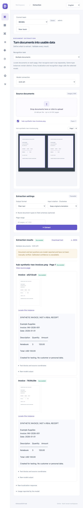

# ChineseOCR Hub

**Multimodal OCR and schema-driven document extraction**, available through the browser, HTTP API, CLI and Python library. All visual stages—full-text OCR, document localization/classification and field extraction—use the selected multimodal model. No separate traditional OCR engine or model weights are bundled.

**v0.6.0a1 · Alpha · Community and online multi-tenant modes.** Python 3.12+, macOS/Linux or Docker/WSL2. No frontend build or GPU is required for the workbench; configure a separately hosted vision endpoint.

[中文](README.md) · [User guide](docs/user-guide.en.md) · [Docker operations](docs/docker.en.md) · [Applications and public API](docs/applications.md) · [Multimodal guide](docs/multimodal-ocr.md) · [API](docs/api.md) · [Validation](docs/validation.md) · [Contributing](CONTRIBUTING.md)

Repository: [chineseocr/chineseocr-hub](https://github.com/chineseocr/chineseocr-hub). This is an Alpha; review the validation record before adopting it.

## Application catalog and published APIs

Manage 100+ scenarios with server-side search/pagination, categories, tags, owners, copy, current-page bundle import/export, version diffs and immutable releases. Each application owns its fields and system/user prompts; new drafts do not change a published template/provider/mode snapshot. Activate historical releases or disable new public calls.

Explicitly install **17 editable credential configurations**: identity-card front/back, passport, driving license, vehicle license front/supplement, business license, bank/social-security cards, residence/travel permits, marriage/birth/property certificates and vehicle conformity certificates. Reinstallation preserves edits. These are configurable schemas/prompts, not separately validated recognition models.

Upload with `POST /v1/files`, submit `POST /v1/apps/{code}/recognitions`, then poll `GET /v1/jobs/{id}`. Application-scoped SaaS keys cannot read management settings or other applications; own-upload/own-job boundaries are enforced. Clients need no internal model/profile IDs. See the [guide](docs/applications.md) and [client](examples/recognize_application.py).

## Recognition before configuration

- **General tables**: schema-free page KV, multi-row headers, body cells and merged-cell spans, source highlighting and CSV/HTML exports. Optional projection deskew and contextual/table-band localization. See the [guide](docs/tables-and-localization.md).
- **Full-text OCR**: upload images/PDFs without defining fields. Return text or Markdown, text blocks, model-reported positions, raw output and actual usage. Download JSON/TXT/Markdown.
- **Multiple documents**: localize with the model, make real crops, then recognize each instance. Same-type documents have distinct IDs, source boxes and results.
- **Class routing**: bind document classes to versioned field applications; unconfigured or unknown classes use full-text OCR. Each job freezes route templates and OCR/localization prompts.
- **Structured extraction**: visual KV/group/table configuration, bounded JSON Schema, prompt versions, dictionary enum snapshots, output validation and exact ground-truth field evaluation.
- **Service workflow**: durable per-page/per-instance checkpoints, idempotency, cancellation and explicit reruns. Optional accounts, isolated teams, roles, scoped API keys and usage quotas.
- **Chinese/English UI**: persistent preference; user prompts, business values and model output are preserved as data.



[v0.6 page tabs and linked source review](docs/workbench-review.en.png), shown in the narrow-window responsive layout.

## Quick start

```bash
python3.12 -m venv .venv
source .venv/bin/activate
pip install --require-hashes -r requirements.lock
python -m workbench
```

Open http://127.0.0.1:8765 and sign in with the token in `data/access-token`. Alternatively set `WORKBENCH_TOKEN` (at least 16 characters). The token grants full workspace access. Start the backend instead of opening static/index.html directly.

For step-by-step setup, read **[Qwen-VL self-hosting and OpenAI API](docs/model-connections.en.md)**: prerequisites, optional GPU Compose, exact UI values, parameter profiles, a first recognition and troubleshooting.

Under **Model connections**, save a vision-capable Chat Completions endpoint accepting PNG `image_url` data URLs. Service roots normalize to `/v1`; model discovery does not establish recognition quality. In **Extraction → Recognition task**, choose full-text OCR, multiple documents, or custom field extraction. Use `?lang=en` for English. New workspaces have a starter schema, no files or precomputed scores.

## CLI and library

```bash
export WORKBENCH_MODEL_BASE_URL=https://vision.example.test/v1
export WORKBENCH_MODEL_NAME=your-vision-model
export WORKBENCH_MODEL_API_KEY=your-private-key
python -m workbench ocr examples/synthetic-invoice.png --format text
python -m workbench ocr examples/synthetic-multipage.pdf --format markdown --output invoice.md
python -m workbench documents combined-documents.png --format json --output instances.json
```

Credentials stay in private runtime configuration. CLI ingestion uses the same bounded image/PDF pipeline in a temporary workspace. `workbench.vision.recognize` and `locate` are independent library APIs; HTTP users submit `POST /api/recognition/jobs` and poll standard job endpoints. See the [guide](docs/multimodal-ocr.md) for examples and contracts.

## Scope and limits

| Capability | Current boundary |
|---|---|
| Text, Markdown, text blocks | Implemented through the selected multimodal service; model-reported positions are unverified, unavailable boxes and confidence are null |
| Localization/crops/class routing | Implemented; at most 12 instances/page, real authenticated crops, separate same-class IDs and partial failures |
| Source coordinates | Inverse rotation/crop mapping to preview pixels and oriented original-image pixels or PDF points; legacy metadata explicitly falls back to preview pixels |
| Images/PDFs | 20MB/file, 20 pages/PDF, 5 files/job, 20 page units/job; rendering capped at 1600px; structured joint input up to 8 pages/file |
| Orientation | EXIF, manual quarter-turn rotation, optional ±8° projection deskew and inverse mapping; no content-based quarter-turn detector or perspective correction |
| Tables/exports | Generic table headers/body/merged spans, CSV and escaped HTML exports; no Excel, searchable PDF or pixel-exact page reconstruction |
| Evaluation/review | Exact business-JSON leaf comparison; no representative CER/IoU/table benchmark, human correction workflow, continuation merging or front/back pairing |
| Recovery | Completed localization and instances are reused after restart; interrupted in-flight calls can still be billed twice; errors are not automatically retried |

Multiple-document processing costs one localization call plus one call per instance. Page quotas count admitted input pages, not the number of model requests. Token counters include only actual reported fields, never estimates. Coordinates passing validation do not prove accuracy, and successful jobs do not guarantee correct text. Existing ocr-app-v7 specialized models and postprocessing have not been fully migrated.

The open-source value is a callable recognition core with visible source evidence, reproducible configuration and recoverable execution. Account management supports collaboration; CLI/library recognition remains independently useful. Synthetic live-model checks verify execution, not commercial accuracy.

## Online multi-tenant mode

```bash
export WORKBENCH_ALLOWED_MODEL_BASES=https://vision.example.test/v1
python -m workbench --mode saas --data-dir data
```

Read generated credentials privately from `data/saas/initial-admin.json`, change the password, then remove the bootstrap file. Registration defaults to invitation-only. Exact operator URL allowlists are checked during discovery, save and every inference stage; a blank list denies all destinations. Community data and operator model profiles are never automatically inherited by tenants.

Teams have separate SQLite databases and private files; every request checks current membership. Scoped API keys cannot switch teams or manage model connections. Platform administration manages metadata/limits without implicit document access. Password changes revoke all account sessions/API keys. SaaS model secrets are encrypted using a private master key; community secrets use a permission-protected local database.

One process/data directory, at most 100 teams and four concurrent model calls. This Alpha does not provide HA, SSO, payment processing, email verification, retention cleanup or a parser sandbox. Quotas cover admitted pages and original/preview storage, not all disk usage or billing. Back up the complete stopped data directory including the master key. See [SaaS operations](docs/saas.md).

## Docker deployment

Run from the project root. Copy the example only for a new deployment without `.env`; preserve private configuration when upgrading.

```bash
cp .env.example .env
chmod 600 .env
docker compose config --quiet
docker compose build --pull
docker compose up -d
docker compose ps
docker compose exec workbench cat /app/data/access-token
```

Open [http://127.0.0.1:8765/?lang=en](http://127.0.0.1:8765/?lang=en) and use the generated token, or your configured `WORKBENCH_TOKEN`. The locally built image is `chineseocr-hub:0.6.0a1`; no official registry image is available yet. It runs as UID/GID `10001:10001`, with a health check, rotated logs and a 200-second stop grace period. No workbench GPU is required; host the model separately.

For SaaS, set `WORKBENCH_MODE=saas` and actual `WORKBENCH_ALLOWED_MODEL_BASES` in `.env` before starting. Privately read `/app/data/saas/initial-admin.json`, sign in, change the password and delete that file. Teams configure their own model connections; community `WORKBENCH_MODEL_*` profiles are not inherited.

Data lives in a project-prefixed named volume. Normal `down` retains it; `down -v` deletes it. Apply environment edits with `docker compose up -d --force-recreate`, not only `restart`. A host model can use `host.docker.internal`; on Linux it must also listen on a bridge-reachable interface. See the **[Docker operations guide](docs/docker.en.md)** for configuration, networking, backups/restores, upgrades, offline distribution and troubleshooting.

Ports bind host loopback. Managed access needs HTTPS, domain routing, ingress/egress controls and backups. Use one process/container per data directory. Linux CI has passed actual image builds and community/SaaS container checks. Compose checks currently validate configuration; the complete operational workflow and business capacity still require acceptance testing. See [validation](docs/validation.md).

## Documentation and recommended workflow

| Stage | Guide |
|---|---|
| Install and sign in | [Docker](docs/docker.en.md), [Python/ingress](docs/deployment.md), [SaaS](docs/saas.md) |
| Deploy or purchase a model | [Connection examples](docs/model-connections.en.md): self-hosted Qwen3-VL / OpenAI API |
| First recognition and UI workflow | [User guide](docs/user-guide.en.md): connect a model, upload synthetic input, review text/tables and PDF source links |
| Configure and evaluate | [Fields/prompts/dictionaries](docs/configuration.md), [applications](docs/applications.md), [tables](docs/tables-and-localization.md); evaluation steps are in the user guide |
| Integrate and develop | [API](docs/api.md), [CLI/library](docs/multimodal-ocr.md), [code guide](docs/code-guide.md) |
| Release and assess limits | [Release checks](docs/releasing.md), [validation](docs/validation.md), [capabilities](docs/ocr-capabilities.md) |

## Development

```bash
pip install -r requirements-dev.txt
python -m pytest -q
ruff check workbench tests scripts
ruff format --check workbench tests scripts
python scripts/build_release.py
python scripts/verify_release.py dist/chineseocr-hub-0.6.0a1.tar.gz --smoke
```

See [architecture](docs/architecture.md), [deployment](docs/deployment.md), [code guide](docs/code-guide.md), [security](SECURITY.md) and [release checks](docs/releasing.md). Python contracts and frontend source include readable comments. Runtime substitutes exist only in tests; production never falls back to fixed answers.

Newly authored code and synthetic fixtures use Apache-2.0; dependencies retain their licenses. No customer documents, private endpoints, legacy customer-specific code, activation checks or weights are included. The source is Alpha; no official PyPI package or container image has been published. Maintainer: [wenlihaoyu](https://github.com/wenlihaoyu). Check actual remote results under [GitHub Actions](https://github.com/chineseocr/chineseocr-hub/actions); workflow configuration alone does not establish a pass. Follow [SECURITY.md](SECURITY.md) for sensitive reports.
