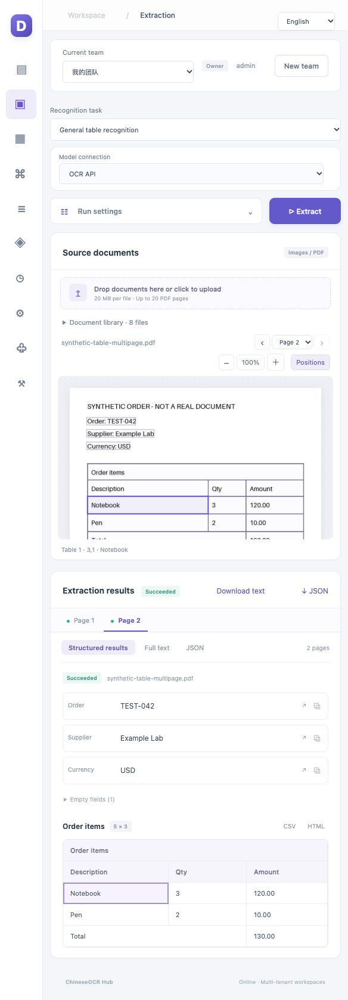

# ChineseOCR Hub

A multimodal OCR and document extraction workbench. Upload images or PDFs, recognize text, tables and credentials, extract custom JSON fields, and connect the results to your systems through an API.

[中文](README.md) · [User guide](docs/user-guide.en.md) · [Connect a model](docs/model-connections.en.md) · [Examples](examples/use-cases.en.md)

**v0.6 Alpha** · Python 3.12+ · Chinese / English · Apache-2.0

## Features

- **Full-text OCR**: convert images and multi-page PDFs to text or Markdown.
- **Tables**: extract page KV, headers, body cells and merged spans; export CSV / HTML.
- **Credentials and invoices**: 17 editable credential configurations; locate, crop and recognize multiple documents in one image.
- **Custom fields**: configure fields, groups and item arrays; version prompts and dictionaries; evaluate against datasets.
- **Source review**: PDF page tabs and linked fields, table cells and image boxes.
- **Integration**: Web, API, CLI and Python library; community self-hosting and online multi-tenant modes.



## Quick start

Install Docker and Compose, then run:

```bash
git clone https://github.com/chineseocr/chineseocr-hub.git
cd chineseocr-hub
cp .env.example .env
chmod 600 .env
docker compose up --build -d
docker compose exec workbench cat /app/data/access-token
```

Open [http://127.0.0.1:8765/?lang=en](http://127.0.0.1:8765/?lang=en) and sign in with the token printed above.

1. Save a vision-capable connection under **Model connections**.
2. Select a recognition task, upload a document and run it.
3. Review results alongside the source and download text, JSON or tables.

Use a separately hosted model or cloud API: [self-hosted Qwen-VL / OpenAI API tutorial](docs/model-connections.en.md). The workbench itself needs no GPU. See [Docker operations](docs/docker.en.md) for installation, SaaS setup and maintenance.

## Examples

| Scenario | Workflow and sample |
|---|---|
| Image to text | Run full-text OCR on the [sample invoice](examples/synthetic-invoice.png); [steps](examples/use-cases.en.md#1-image-to-text) |
| PDF to Markdown | Upload a [two-page PDF](examples/synthetic-multipage.pdf), then review page tabs; [steps](examples/use-cases.en.md#2-multi-page-pdf-to-markdown) |
| Tables and page KV | Extract supplier, currency and items from the [sample order](examples/synthetic-table.png); [steps](examples/use-cases.en.md#3-tables-and-page-kv) |
| Identity cards, passports and other credentials | Install a configuration and customize its fields/prompts; [steps](examples/use-cases.en.md#4-credential-fields) |
| Invoice to JSON | Configure invoice number, vendor, total and an items array; [steps](examples/use-cases.en.md#5-invoices-and-line-items) |
| Grouped expenses | Configure department, subtotal and nested items with the [schema](examples/grouped-expenses.schema.json); [steps](examples/use-cases.en.md#6-grouped-expenses) |
| Multiple documents in one image | Choose Multiple documents for the [two-invoice image](examples/synthetic-multiple-invoices.png); [steps](examples/use-cases.en.md#7-multiple-documents-in-one-image) |
| Compare prompt versions | Evaluate against [invoice ground truth](examples/synthetic-invoice.gold.json); [steps](examples/use-cases.en.md#9-compare-prompt-versions) |
| Recognition API | Publish an application and call its stable application code; [steps](examples/use-cases.en.md#8-publish-an-api) |

After installing Python dependencies and [setting model environment variables](examples/use-cases.en.md#cli-setup), run:

```bash
python -m workbench ocr examples/synthetic-invoice.png --format text
python -m workbench ocr examples/synthetic-multipage.pdf --format markdown --output invoice.md
python -m workbench tables examples/synthetic-table.png --output table.json
python -m workbench documents examples/synthetic-multiple-invoices.png --output documents.json
```

## Documentation

| Topic | Guides |
|---|---|
| Installation and usage | [Docker](docs/docker.en.md) · [Python](docs/deployment.md) · [User guide](docs/user-guide.en.md) · [Examples](examples/use-cases.en.md) |
| Models and extraction rules | [Qwen / OpenAI](docs/model-connections.en.md) · [Fields, prompts and dictionaries](docs/configuration.md) · [Applications](docs/applications.md) |
| Development and integration | [API](docs/api.md) · [CLI / Python](docs/multimodal-ocr.md) · [SaaS](docs/saas.md) · [Code guide](docs/code-guide.md) |
| Maintenance | [Features and limits](docs/ocr-capabilities.md) · [Testing](docs/validation.md) · [Contributing](CONTRIBUTING.md) · [Security](SECURITY.md) |

Licensed under [Apache-2.0](LICENSE). See [third-party notices](THIRD_PARTY_NOTICES.md) for dependency licenses.
