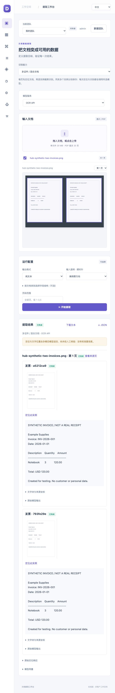

# ChineseOCR Hub

面向开发者和集成商的 **多模态 OCR 与文档结构化提取工具**，仓库名 **`chineseocr-hub`**，延续 ChineseOCR 品牌。全文识别、多文档定位、分类与字段提取统一使用你配置的多模态模型，可通过页面、API、CLI 或 Python 库调用。

**v0.6.0a1 · Alpha · 本地社区版 + 在线多租户版** · Python 3.12+ · 工作台无需 Node.js 或 GPU

支持 macOS/Linux；Windows 请使用 Docker 或 WSL2。模型服务可独立部署在本地或云端，项目不捆绑 OCR 引擎、权重或客户数据。

[English](README.en.md) · [操作手册](docs/user-guide.md) · [Docker 部署](docs/docker.md) · [应用管理与公开 API](docs/applications.md) · [多模态 OCR 使用](docs/multimodal-ocr.md) · [API](docs/api.md) · [验证记录](docs/validation.md) · [贡献指南](CONTRIBUTING.md)

项目仓库：[chineseocr/chineseocr-hub](https://github.com/chineseocr/chineseocr-hub)。当前为 Alpha；请按验证记录评估适用范围。

## 管理每一种提取场景

「应用管理」提供名称/编码/标签/负责人搜索、分类与状态过滤、服务器分页、复制、当前页配置导入导出。每个应用保存自己的字段、系统/用户提示词和不可变版本；对比修改后，可发布固定配置与模型连接，切换历史发布或停用公开调用。新草稿不影响线上版本。

点击「安装常用证件配置」可将 **17 套**配置保存为团队内可编辑草稿：身份证正反面、护照、驾驶证、行驶证正副页、营业执照、银行卡、社保卡、居住证、港澳/台湾及来往内地通行证、结婚证、出生医学证明、不动产权证和车辆合格证。重复安装保留已有修改；新建应用也可单独选择。配置库不代表专项模型精度验收。

对外调用：`POST /v1/files` 上传 → `POST /v1/apps/{code}/recognitions` 提交 → `GET /v1/jobs/{id}` 查询。在线版可创建限定应用的 API Key，只访问获准应用及该 Key 的上传/任务，不能读取管理后台。调用方无需知道提示词和模型连接。详见 [应用与 API 指南](docs/applications.md)。

## 先识别，再按业务配置

- **通用表格**：无需配置字段，提取页面 KV、多级表头、表体及合并单元格；点击来源定位，下载 CSV/HTML。支持可选小角度纠偏与上下文/行列锚点定位。见 [表格与定位指南](docs/tables-and-localization.md)。
- **全文 OCR**：无需定义字段，上传图片或 PDF，得到全文、Markdown、文字块与来源位置；导出 JSON/TXT/Markdown。
- **多证件 / 混合文档**：同一模型先定位，再实际裁剪，逐实例识别。同类多张证件分别保存，可查看裁剪并定位回来源页。
- **类别路由**：身份证、发票等类别可分别绑定字段应用；未配置的类别执行全文识别。提交时固定路由版本，避免所有图片都套用当前票据字段。
- **业务提取**：可视化 KV、对象分组和明细表，应用目录、配置发布、字段/提示词不可变版本、字典 enum 快照、JSON 校验和标准答案评测。
- **服务化**：持久化队列、逐页/逐实例恢复、幂等提交、取消、重跑；社区令牌或在线账户/独立团队/角色/API key/用量额度。
- **中英文页面**：系统文案适配，切换不改写用户提示词、业务字段、文件名或模型原文。



截图使用项目合成票据与真实多模态服务响应，不含客户资料。v0.6 的 PDF 页签与图像框双向核对见 [新版工作台截图](docs/workbench-review.zh.png)。提示词、字段和字典入口见 [配置说明](docs/configuration.md)。

## 实际能力与边界

| 能力 | 实现与限制 |
|---|---|
| 全文、Markdown、文字位置 | 已实现独立多模态流程；位置来自模型，缺失为 null，未经核验，不编造置信度 |
| 多文档定位、分类、裁剪、实例路由 | 已实现；最多 12 实例/页，各自保留 ID、裁剪图、来源框、结果和失败状态 |
| 图片、多页 PDF、页范围 | 已实现；OCR/多文档逐页处理，业务联合提取最多 8 页/文件；不自动合并续表 |
| 原图坐标 | 新上传图片映射至 EXIF 归一化后原图像素，PDF 映射至 points；旧元数据不足时标记预览坐标 |
| 方向与图像质量 | EXIF、手动旋转、可选 ±8° 投影纠偏及四角逆映射；无自动 90° 内容方向检测或透视矫正；预览最长边 1600px |
| 原表与导出 | 通用表格保留表头/表体和合并跨度，导出 CSV/HTML；无 Excel、可搜索 PDF 或原版像素排版复刻 |
| 评测与复核 | 业务 JSON 叶子字段精确比较；无完整 CER/IoU/表格基准、审核回写、正反面自动配对 |
| 推理部署 | 所有视觉任务调用所选多模态服务；不安装另一套传统 OCR 引擎，不包含模型权重 |

模型定位合法不等于准确，任务成功不等于每个字或字段正确。详见 [能力审计](docs/ocr-capabilities.md)。旧 ocr-app-v7 的专用模型、权重及专项后处理未整体迁移。

## 开源价值

核心识别不依赖先配置管理页面：CLI 和 Python 接口可以独立完成首次 OCR。工作台在其上提供版本化业务规则、真实裁剪和来源证据、可恢复任务与评测。原始输出、失败和真实用量保留，方便社区替换多模态模型、复现问题和扩展场景。账号与多租户承载协作，识别能力本身也可以独立复用。

## 本地启动

推荐 Python 3.12，在项目目录执行：

```bash
python3.12 -m venv .venv
source .venv/bin/activate
pip install --require-hashes -r requirements.lock
python -m workbench
```

打开 [http://127.0.0.1:8765](http://127.0.0.1:8765)，不要直接双击 `workbench/static/index.html` 作为应用入口。另开终端运行 `cat data/access-token`，把令牌填入登录页。令牌自动生成且不会写入服务日志。也可在启动前设置至少 16 字符的 `WORKBENCH_TOKEN`；设置环境变量时以环境变量为准。令牌拥有整个工作空间的管理权。

如果使用 uv：`uv venv --python 3.12 && uv pip install --require-hashes -r requirements.lock && .venv/bin/python -m workbench`。

首次启动只建立字段模板，不生成识别结果或评测分数。先配置真实图像模型，再上传文档运行。合成测试文件和标准答案单独放在 `examples/`；只有明确上传、添加样本并执行后才产生结果。

页面右上角可切换 **中文 / English**，语言选择会保留。导航、表单、状态、错误、日期和评测均适配；用户字段、提示词、文件名及模型原文不会因切换语言而改写。也可通过 `?lang=zh` 或 `?lang=en` 打开指定语言。

## 在线多租户启动

```bash
python -m workbench --mode saas --data-dir data
```

从 `data/saas/initial-admin.json` 私下读取自动生成的管理员账户；登录后在「团队与用量」修改初始密码，旧会话和接口密钥随之撤销，并删除初始凭据文件。默认邀请注册，不自动发送邮件。账户可加入多个团队，切换团队会清空页面上下文。平台管理员可配置额度、停用账户，但没有其他团队文档的隐式访问权。

运行前由平台运维在 `WORKBENCH_ALLOWED_MODEL_BASES` 设置允许的模型 API 地址；留空时禁止创建模型连接。各团队管理员随后独立保存模型连接，密钥使用平台主密钥加密。**本地版已有数据不会自动加入任何在线团队**。完整配置、角色矩阵、备份与限制见 [在线版指南](docs/saas.md)。

## 使用真实模型

1. 在「模型接入」填写 Base URL 和 API Key，检测连接、选择实际模型 ID 并保存。
2. 服务须支持 `POST /chat/completions` 和 PNG `image_url` data URL。选择连接，上传合成票据先验证。
3. 在「提取工作台 → 识别能力」选全文 OCR、通用表格或多文档，设置页范围/旋转/纠偏/定位策略，开始识别。
4. 查看全文、来源位置、裁剪、原始输出和实际用量；下载文本或 JSON。多文档可按类别配置字段路由。
5. 需要业务字段时切换自定义字段提取，新建匹配应用，在「字段与表格」「提示词版本」配置并保存；未保存草稿会先保存新版本。
6. 给数据集样本填写业务 JSON 标准答案，运行评测比较配置版本。此评测不是全文字符或检测精度指标。

无需启动 Web 服务的命令行入口：

```bash
# 先设置文末所列的私有模型环境变量
python -m workbench ocr examples/synthetic-invoice.png --format text
python -m workbench ocr examples/synthetic-multipage.pdf --format markdown --output invoice.md
python -m workbench documents combined-documents.png --format json --output instances.json
```

HTTP、Python 库、提示词位置和输出坐标约定见 [多模态 OCR 指南](docs/multimodal-ocr.md)。

连接本地 vLLM 等服务不要求外部云端。只有显式提交识别/提取/评测时才向所选模型发送经过缩放的页面 PNG 和提示词。模型服务的视觉能力、上下文容量和许可需要自行确认。当前适配器不使用工具调用或服务端 JSON Schema 参数，也不支持仅提供 Responses API 的端点。

## 字段与多页结构

页面字段编辑器支持普通字段、对象分组及对象数组（明细表）。字段右侧「⋯」可直接编辑可选值，或复制「字典管理」中的指定版本；复制结果作为 `enum` 随应用版本保存，后续字典更新不会改写旧应用和任务。JSON Schema 导入可配置更多嵌套结构。根结构为 object，最多 6 层，不支持 `$ref`、正则表达式或任意代码。字段类型支持 null，**required 表示 key 必须存在，不等于禁止 null**。表头名称填写在列字段说明中。

```json
{
  "invoice_number": "INV-2026-001",
  "vendor": "Example Supplies",
  "total": 120,
  "items": [{"description": "Notebook", "quantity": 3, "amount": 120}]
}
```

更复杂的「分组 KV + 表体」配置见 [混合表格 Schema](examples/grouped-expenses.schema.json)。独立文件分别处理，不跨文件合并；一张图的多个证件使用「多证件 / 混合文档」定位与裁剪，不在自定义字段模式隐式拆分。

| 项目 | 首版范围 |
|---|---|
| 文件 | PNG/JPEG/WEBP/单页 TIFF、PDF；单文件 20MB、图片最多 1600 万像素 |
| PDF | 最多 20 页；预览最长边 1600px，模型看到的是该预览 |
| 联合模式 | 每个文件一次提交最多 8 页，输出一个业务 object |
| 逐页 / OCR / 多文档 | 每页一个处理单元，最多 20 单元；多文档每页最多 12 实例，不自动合并续表 |
| 任务 | 单任务最多 5 个文件；持久化队列最多 100 个排队/执行任务；单工作进程 |
| 数据集 | 每集最多 50 个样本；每个样本一个文件及一个标准答案 object；联合提取最多 8 页 |
| 评测 | 标准答案叶子字段精确比较，缺失/失败计入分母，数组按位置对齐，额外输出字段单独列出 |

## Docker

在项目根目录执行。首次部署且还没有 `.env` 时，复制示例后编辑；升级时保留原私有配置：

```bash
cp .env.example .env
chmod 600 .env
docker compose config --quiet
docker compose build --pull
docker compose up -d
docker compose ps
docker compose exec workbench cat /app/data/access-token
```

访问 [http://127.0.0.1:8765/?lang=zh](http://127.0.0.1:8765/?lang=zh)，使用自动生成的社区令牌登录；若 `.env` 设置了 `WORKBENCH_TOKEN`，直接使用该值。镜像在本地构建为 `chineseocr-hub:0.6.0a1`，尚未提供官方仓库镜像。容器以 UID/GID `10001:10001` 运行，带健康检查、日志轮转及 200 秒停止宽限期；工作台无需 GPU，模型服务独立部署。

在线版先在 `.env` 设置 `WORKBENCH_MODE=saas`、实际的 `WORKBENCH_ALLOWED_MODEL_BASES`，然后启动。从 `/app/data/saas/initial-admin.json` 私下读取初始账户，登录后改密并删除引导文件。各团队在页面独立配置模型；社区版 `WORKBENCH_MODEL_*` 不下发给团队。

数据保存在带 Compose 项目前缀的命名卷 `workbench-data`；普通 `down` 保留数据，`down -v` 会删除。修改 `.env` 后用 `docker compose up -d --force-recreate`，仅 `restart` 不更新环境。连接宿主机模型可使用 `host.docker.internal`；Linux 还需模型监听容器可达接口。完整的配置、模型网络、停机备份/恢复、升级、离线镜像导出与排障见 **[Docker 操作指南](docs/docker.md)**。

默认只发布本机端口；公网入口需配置 HTTPS、域名、网关限速和备份。同一数据卷只能运行一个实例，不支持多 workers/多容器共享目录扩容。Linux CI 已实际通过镜像构建和社区/SaaS 容器验证；Compose 检查目前覆盖配置解析，完整运维与业务容量仍需自行验收，见 [验证记录](docs/validation.md)。

## 文档导航与推荐上手顺序

| 阶段 | 文档 |
|---|---|
| 部署与登录 | [Docker 指南](docs/docker.md)、[Python/公网部署](docs/deployment.md)、[在线多租户](docs/saas.md) |
| 第一次识别与页面操作 | [完整操作手册](docs/user-guide.md)：模型接入 → 合成样本 → 文字/表格 → PDF 页签与来源框核对 |
| 业务配置与验证 | [字段、提示词与字典](docs/configuration.md)、[应用及证件模板](docs/applications.md)、[表格与定位](docs/tables-and-localization.md)；数据集步骤见操作手册 |
| 系统集成与开发 | [API](docs/api.md)、[CLI/Python](docs/multimodal-ocr.md)、[代码阅读](docs/code-guide.md) |
| 发布与能力边界 | [发布检查](docs/releasing.md)、[验证记录](docs/validation.md)、[能力范围](docs/ocr-capabilities.md) |

## 开发与验证

```bash
pip install -r requirements-dev.txt
python -m pytest -q
ruff check workbench tests scripts
ruff format --check workbench tests scripts
python scripts/generate_examples.py
python scripts/build_release.py
python scripts/verify_release.py dist/chineseocr-hub-0.6.0a1.tar.gz --smoke
```

`requirements.lock` 固定运行依赖及分发包哈希；更新时用 `uv pip compile requirements.txt --generate-hashes -o requirements.lock` 并重新验证。已用真实 `ocr-model-0.1` 接口验证图片、双页 PDF 联合/逐页提取和数据集评测。具体已验证项和未验证项以 [验证记录](docs/validation.md) 为准。自动化通过不等于已经验证真实模型精度或商业可用性。

## 架构与扩展

FastAPI + SQLite WAL + 每工作空间一个持久化任务 worker + 原生 HTML/CSS/JS。无需前端构建服务。模型适配见 `workbench/adapters.py`；独立多模态识别与几何契约见 `workbench/vision.py`，持久化实例流水线见 `workbench/recognition.py`。设计与数据安全说明见 [架构](docs/architecture.md) 和 [SECURITY.md](SECURITY.md)。

Apache-2.0 仅适用于本目录新编写的项目代码与合成示例，第三方依赖保留各自许可，见 [LICENSE](LICENSE)、[NOTICE](NOTICE) 和 [第三方声明](THIRD_PARTY_NOTICES.md)。旧版 ocr-app-v7、客户资料、模型权重与本发布包相互独立。源码为 Alpha，尚未发布官方 PyPI 包或容器镜像。

商业服务可围绕票种/表格适配、效果评估、部署支持、多模态识别效果优化和业务系统连接展开。通用功能和修复建议贡献到主干；客户专属配置应独立管理，不提交到公开 Issue。

## 部署时配置模型

可在页面配置并保存在私有数据库，或在环境中设置：

```bash
export WORKBENCH_MODEL_BASE_URL=https://vision.example.test/v1
export WORKBENCH_MODEL_NAME=your-vision-model
export WORKBENCH_MODEL_API_KEY=your-private-key
python -m workbench
```

Base URL 和模型名称必须同时设置。已有相同配置会复用，环境变量配置选为默认连接；不覆盖历史任务快照。Compose 从 `.env` 读取这些变量。自己的服务地址和密钥不应写入源码或提交仓库。

升级旧候选版时，固定输出连接、对应历史任务和纯初始样本会归档保留，不显示为真实识别结果，也不允许重跑为真实任务。用户真实数据和模板版本保留。上线部署说明见 [deployment.md](docs/deployment.md)，代码阅读顺序及关键约束见 [code-guide.md](docs/code-guide.md)。

## 发布与维护

发布前按 [发布检查](docs/releasing.md) 执行。本机已验证项以 [验证记录](docs/validation.md) 为准；远程执行结果查看 [GitHub Actions](https://github.com/chineseocr/chineseocr-hub/actions)，不能以配置存在代替通过记录。CI 包含 Linux/macOS 测试、依赖审计、容器非 root 启动、鉴权、上传和重启持久化检查。维护者：[wenlihaoyu](https://github.com/wenlihaoyu)；敏感问题按 [安全说明](SECURITY.md) 私下报告。
