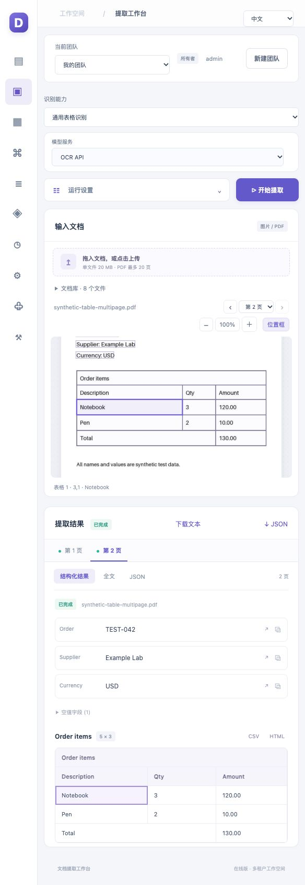

# ChineseOCR Hub

基于多模态大模型的 OCR 与文档提取工作台。上传图片或 PDF，识别文字、表格和证件，按自定义字段输出 JSON，并通过 API 接入业务系统。

[English](README.en.md) · [操作手册](docs/user-guide.md) · [模型接入](docs/model-connections.md) · [使用案例](examples/use-cases.md)

**v0.6 Alpha** · Python 3.12+ · 中文 / English · Apache-2.0

## 能做什么

- **全文 OCR**：图片、多页 PDF 转文字或 Markdown。
- **表格提取**：识别页面 KV、表头、表体和合并单元格，导出 CSV / HTML。
- **证件与票据**：提供 17 套可编辑证件配置；同一图像中的多份文档可分别定位、裁剪和提取。
- **自定义字段**：可视化配置字段、分组和明细表，管理提示词、字典及版本，用数据集评测效果。
- **来源核对**：PDF 分页查看，点击字段或表格单元格联动图像位置框。
- **系统集成**：Web、API、CLI、Python 库；支持社区自部署及在线多租户模式。



## 快速启动

安装 Docker 与 Compose 后执行：

```bash
git clone https://github.com/chineseocr/chineseocr-hub.git
cd chineseocr-hub
cp .env.example .env
chmod 600 .env
docker compose up --build -d
docker compose exec workbench cat /app/data/access-token
```

打开 [http://127.0.0.1:8765](http://127.0.0.1:8765)，使用上面读取的令牌登录。

1. 在「模型接入」保存支持图像输入的模型连接。
2. 在「提取工作台」选择识别能力，上传文档并运行。
3. 查看结果与来源图像，下载文本、JSON 或表格。

模型服务独立部署或使用云端 API：[Qwen-VL 自部署 / OpenAI API 接入教程](docs/model-connections.md)。工作台本身无需 GPU。Python 启动见 [Python 部署](docs/deployment.md)，在线模式与容器运维见 [Docker 指南](docs/docker.md)。

## 使用案例

| 场景 | 操作与示例 |
|---|---|
| 图片转文字 | 选择「全文 OCR」，上传 [示例票据](examples/synthetic-invoice.png)；[步骤](examples/use-cases.md#1-图片转文字) |
| PDF 转 Markdown | 上传 [双页 PDF](examples/synthetic-multipage.pdf)，按页签查看；[步骤](examples/use-cases.md#2-多页-pdf-转-markdown) |
| 表格 + 页面 KV | 上传 [订单表格](examples/synthetic-table.png)，提取供应商、币种及商品明细；[步骤](examples/use-cases.md#3-表格与页面-kv) |
| 身份证 / 护照等证件 | 安装证件配置，选择对应应用，修改字段和提示词；[步骤](examples/use-cases.md#4-证件字段提取) |
| 票据转业务 JSON | 配置发票号码、销售方、总额及明细数组；[步骤](examples/use-cases.md#5-票据与明细表) |
| 报销分组明细 | 使用 [分组 Schema](examples/grouped-expenses.schema.json) 配置部门、小计和明细；[步骤](examples/use-cases.md#6-报销分组与嵌套明细) |
| 同图多份文档 | 上传 [双票据图片](examples/synthetic-multiple-invoices.png)，选择「多证件 / 混合文档」；[步骤](examples/use-cases.md#7-同图多份文档) |
| 提示词效果对比 | 使用 [票据标准答案](examples/synthetic-invoice.gold.json) 比较不同版本；[步骤](examples/use-cases.md#9-比较提示词版本) |
| 对外提供识别 API | 发布应用，通过固定应用编码上传、提交和查询；[步骤](examples/use-cases.md#8-发布为-api-服务) |

安装 Python 依赖并[配置模型环境变量](examples/use-cases.md#命令行准备)后，也可直接使用 CLI：

```bash
python -m workbench ocr examples/synthetic-invoice.png --format text
python -m workbench ocr examples/synthetic-multipage.pdf --format markdown --output invoice.md
python -m workbench tables examples/synthetic-table.png --output table.json
python -m workbench documents examples/synthetic-multiple-invoices.png --output documents.json
```

## 文档

| 内容 | 入口 |
|---|---|
| 安装与使用 | [Docker](docs/docker.md) · [Python 部署](docs/deployment.md) · [操作手册](docs/user-guide.md) · [使用案例](examples/use-cases.md) |
| 模型与业务配置 | [Qwen / OpenAI 接入](docs/model-connections.md) · [字段、提示词与字典](docs/configuration.md) · [应用与证件配置](docs/applications.md) |
| 开发与集成 | [API](docs/api.md) · [CLI / Python](docs/multimodal-ocr.md) · [在线多租户](docs/saas.md) · [代码导读](docs/code-guide.md) |
| 维护 | [功能与限制](docs/ocr-capabilities.md) · [测试](docs/validation.md) · [贡献](CONTRIBUTING.md) · [安全](SECURITY.md) |

本项目采用 [Apache-2.0](LICENSE) 许可，第三方组件见 [许可声明](THIRD_PARTY_NOTICES.md)。
