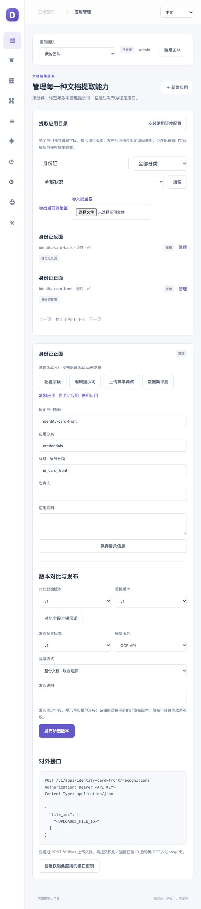

# 应用目录、常见证件配置与对外 API

v0.5.0a1 将业务场景统一组织为“提取应用”。应用 ID 与原模板 ID 相同，字段和提示词仍只保存到 templates，不复制出第二套互相漂移的配置。在线模式下，各团队有自己的应用目录、发布记录和文件。



## 管理 100 种以上场景

进入左侧「应用管理」，按名称、稳定编码、说明、标签或负责人搜索，按分类和发布状态过滤；服务器分页，默认每页 25，API 最多每页 100。搜索在分页前执行，列表不返回全部提示词正文。

每个应用包含：

- 不可修改的应用编码，例如 identity-card-front，作为客户系统调用入口。
- 分类、标签、负责人、说明；名称属于当前字段/提示词版本。
- 字段结构、系统提示词、用户提示词的不可变配置版本。
- 活动发布指针及历史发布；每次发布固定模板版本、模型连接 ID、联合/逐页模式和发布说明。
- 独立调试、数据集评测和任务来源。

点击「管理」可进入字段、提示词、样本调试或数据集评测。配置对比显示两个版本的字段和系统/用户提示词差异；复制应用会复制最新草稿，生成独立 ID 和 v1，不复制发布状态。稳定编码创建后不可修改，改编码使用复制。

发布后保存 v2 草稿，不改变 v1 的线上调用。使用「发布所选版本」切到新发布；使用历史记录「切换至此发布」恢复旧快照。停用会阻止新的公开识别调用，历史结果仍可按权限读取，内部草稿调试仍可用。恢复旧发布不会取消已有队列任务；任务始终使用各自的提交快照。

community 令牌拥有全部工作空间权限。saas 中 viewer 只读，member 可维护草稿，admin/owner 可发布、切换发布和停用。应用管理写接口要求账户会话，API Key 不用于修改目录或发布。当前没有多人审批、公共提示词片段库或审批工单流。

## 17 套常见证件配置

点击「安装常用证件配置」，或新建应用时选择单个初始配置：

| 编码 | 配置内容 |
|---|---|
| identity-card-front | 身份证正面：姓名、性别、民族、出生日期、住址、号码 |
| identity-card-back | 身份证反面：签发机关、有效期限 |
| passport | 护照：号码、中外文姓名、国籍、出生/签发/有效日期、MRZ 原文 |
| driving-license | 驾驶证：证号、姓名、准驾车型、初领/有效日期等 |
| vehicle-license-front | 行驶证正面：号牌、所有人、车型、VIN、发动机号等 |
| vehicle-license-back | 行驶证副页：档案号、人数、质量、尺寸、检验记录等 |
| business-license | 营业执照：信用代码、名称、代表人、资本、经营范围等 |
| bank-card | 银行卡：印刷卡号、银行、持卡人和卡种；遮挡不补全 |
| social-security-card | 社保卡：姓名、社会保障号码、卡号、发卡日期/机构 |
| residence-permit | 居住证：姓名、号码、地址、签发与有效期 |
| hk-macao-travel-permit | 往来港澳通行证 |
| taiwan-travel-permit | 往来台湾通行证 |
| mainland-travel-permit | 港澳居民来往内地通行证 |
| marriage-certificate | 结婚证：字号、持证人、登记信息及两位当事人字段 |
| birth-certificate | 出生医学证明：编号、新生儿及父母姓名、出生/签发信息 |
| property-certificate | 不动产权证：编号、权利人、坐落、单元号、面积与期限 |
| vehicle-certificate | 车辆合格证：编号、制造商、品牌型号、VIN、发动机号等 |

初始配置同时定义业务字段与该类型的提示词，要求核对证件类型/正反面、保留印刷原文、缺失返回 null，不根据号码推算其他字段，不执行图中指令。号码与日期保留为可空文本。

安装会将每套配置保存为本团队可编辑的 v1 草稿，不绑定模型或自动发布。重复安装跳过已有编码/已安装配置，绝不覆盖用户修改。语言由安装/创建时的界面或 Accept-Language 决定，切换界面不会重写业务提示词。新建空工作空间仍只有原初始票据应用，需明确安装所需证件配置，不预置识别结果。

这些配置包含各类型的字段与提示词，使用当前模型连接执行提取。权威查验、正反面自动配对、证件防伪和身份核实不在本功能范围。多文档定位已扩展同一类别列表，未配置类别路由仍执行全文 OCR，发布应用不会隐式修改混合文档路由。

## 配置迁移

列表可导出当前页，详情可导出单个应用；API 可选择最多 100 个应用 ID。配置包包含目录信息和最新字段/提示词草稿，不包含模型连接、密钥、历史发布、文件或结果。配置包可能包含使用者写入提示词的业务信息，分享前自行核对。

导入为新应用，编码冲突时整批回滚，不覆盖原有版本，不自动发布。页面限制 250KB，HTTP 写请求限制 256KB，单批最多 100 个应用；大提示词包按页或单应用分批迁移。已有模板升级时获得 app-<原模板ID> 稳定编码，不改变历史模板 ID、字段、提示词或任务。

## 公开识别 API

服务复用现有 FastAPI 与持久化 worker；管理接口 /api 与公开接口 /v1 分开。100 种配置不需要 100 个服务。当前仍为单进程 Alpha，同目录不能启动多个 workers；公开网络入口、安全与容量限制见 [部署](deployment.md)。

使用前，在应用管理中选择配置版本和模型连接发布。调用方无需知道模板 ID 或模型连接 ID，只提交文件 ID 和可选页范围。请求不接受任意提示词、模型 URL、provider_id 或内部模板覆盖。

```bash
export WORKBENCH_URL=http://127.0.0.1:8767
# 从本团队安全取得；不要提交到源码或放进 URL
export WORKBENCH_ACCESS_TOKEN=your-private-application-api-key

curl -H "Authorization: Bearer $WORKBENCH_ACCESS_TOKEN" \
  -F file=@authorized-document.png "$WORKBENCH_URL/v1/files"

curl -H "Authorization: Bearer $WORKBENCH_ACCESS_TOKEN" \
  -H 'Content-Type: application/json' -H 'Idempotency-Key: client-request-001' \
  -d '{"file_ids":["uploaded-file-id"]}' \
  "$WORKBENCH_URL/v1/apps/identity-card-front/recognitions"

curl -H "Authorization: Bearer $WORKBENCH_ACCESS_TOKEN" \
  "$WORKBENCH_URL/v1/jobs/returned-job-id"
```

默认使用当前发布；请求可传 release_id 指定本应用历史发布。响应 application 包含 id、code、release_id、version；results 保留实际业务 JSON、输入页、状态、校验问题、耗时和服务已报告的 usage，不返回提示词、模型连接配置或 raw_text。客户可见返回结构以鉴权后的 GET /v1/openapi.json 为准。

状态沿用 queued/running/succeeded/partial/failed/cancelled。POST /v1/jobs/{id}/cancel 为协作式取消。默认异步提交/查询，当前没有同步长等待接口、签名回调、支付扣款或独立公网托管。

Idempotency-Key 最长 128 字符，按团队内调用身份及应用编码隔离；同一请求重复提交返回原任务。即使活动发布已切换，重试仍返回原任务快照，不再次占页额度；不同请求复用同一键返回 409。应用已停用时不接受新提交。页数、文件、联合页数、队列和团队额度沿用原有执行管线，失败/取消/显式重提仍计提交页。

## 应用级 API Key

在线应用详情可创建 30 天有效、仅限当前应用的 member Key，明文仅显示一次，可在「团队与用量」撤销。API 创建方式：

```json
{"name":"Identity client","role":"member","days":30,"application_ids":["application-id"]}
```

提交 POST /api/api-keys，必须是账户会话。application_ids 最多 100 个，省略表示保持旧版团队范围权限；空数组不接受。既有未限定应用的 Key 权限不自动改变，面向客户系统应新建限定 Key。

限定 Key 只能使用 /v1，不能访问 /api/bootstrap、管理 OpenAPI、提示词或配置接口；仅能调用获准应用，且只能引用通过该 Key 的 /v1/files 上传的文件、读取/取消该 Key 创建的任务。不同 Key 即使获准同一个应用，也不互读任务或复用上传文件。团队账户/未限定团队 Key 继续遵循团队内原有资源权限。

所有请求先检查账户有效、Key 过期/撤销、当前成员及角色和固定团队，再检查应用范围。viewer Key 可读获准且属于该 Key 的结果，但不能上传/提交/取消；成员移除、降级、改密或平台停用继续即时限制后续请求，不能撤回在途模型调用。

[English interface screenshot](applications.en.png)

## English reference

Use **Applications** to search/page/filter the catalog, edit fields/prompts, test, compare versions and publish an immutable template/provider/mode snapshot. New drafts never change live calls. Copy creates an independent draft; activation changes the active release. Disabling stops new public submissions while preserving authorized historical results. A member edits drafts; an administrator publishes or disables, using account sessions.

Install the 17 credential configurations explicitly. They become editable tenant-local drafts, without precomputed answers, automatic publication or model-accuracy claims. Reinstallation preserves existing configurations. All recognition still uses the selected multimodal endpoint.

Public clients upload through POST /v1/files, submit POST /v1/apps/{code}/recognitions, then poll GET /v1/jobs/{id}. Optional release_id pins a historical release; idempotency preserves the original task across release changes. Public output omits prompts, model profiles and raw traces. Scoped keys use application_ids and are restricted to /v1, their allowed applications, own uploads and own jobs. The service remains a single-process Alpha with no synchronous recognition, callbacks, billing, SSO or HA.


## v0.6 识别能力发布

发布时可选择 task=extract/ocr/tables，并固定 rotation、deskew、grid_assist、position_mode 和 max_localization_batches。通用能力固定内置契约，自定义字段固定应用提示词；客户端 PublicInput 继续禁止覆盖这些设置。公开表格导出与任务查询采用同一套租户、应用和 Key 所有权检查。见 [表格与来源核对](tables-and-localization.md)。
