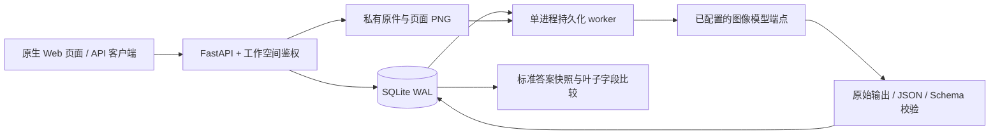

# 架构与运行约束

全文、定位和实例识别均调用配置的多模态模型服务。Web、API、CLI 和 Python 库共享识别与几何处理模块。

## 应用目录与公开契约

applications 保存模板 ID 对应的稳定编码、分类、标签、负责人和活动发布指针；application_releases 保存不可变模板/模型连接 ID/模式快照。模板仍为唯一字段/提示词真源，升级对旧模板只补目录元数据。public_uploads 将公开上传与调用身份关联；平台 api_key_scopes 保存 Key 的应用范围。/v1 由同一租户网关先鉴权，再限定应用与该 Key 的文件/任务；详情见 [应用管理](applications.md)。

## 数据

- `templates(id, version)`：不可变配置快照，结构与 system/user prompt 一起版本化。
- `providers`：不可变连接配置，包含模型和密钥。页面只创建新连接，不覆盖旧配置，任务使用提交时的 provider_id。
- `files`：随机存储键指向私有原件和预览 PNG。客户端只得到数据库 ID。
- `jobs`：状态、输入及模板快照、处理单元、逐单元结果、幂等指纹和取消标志。
- `datasets`：样本文件引用与标准答案。
- `runs`：标准答案和提交任务 ID 的不可变快照。整批任务与 run 在一个数据库事务中创建。

`data/` 默认权限 0700，数据库和令牌 0600。community 模式模型密钥未加密；saas 模式采用平台主密钥加密模型密钥。宿主机用户若拥有数据目录与主密钥权限仍可解密。保护备份及宿主机是部署方职责。

## 执行

单工作空间使用系统文件锁阻止第二个进程共享同一目录。SQLite 事务声明任务，worker 顺序执行，一次模型调用最多 180 秒。任务单元完成后检查点写入数据库；重启把 running 状态恢复到 queued，并跳过已有终态结果。多文档由 `recognition.py` 恢复页内已保存的定位与实例，详见 [多模态处理](multimodal-ocr.md)。

恢复提供至少一次执行语义：在请求已到达模型但结果尚未落库时崩溃，恢复会再次调用该单元，可能重复计费。客户端幂等键只去重创建任务，不保证模型侧恰好一次。相同幂等键不同请求返回 409；显式模板版本便于稳定重试。

模型错误不自动重试。取消为协作式：停止后续单元，无法撤回已发送的 HTTP 调用；当前调用结束/超时后记录 cancelled。手工重跑创建新任务，固定原模板和模型配置，并重跑所有单元。

PDFium 不支持并发访问，页面解析使用进程内锁。PDF 页数及渲染尺寸有界；图像像素数、文件大小、联合页数、任务单元和输出体大小也有界。原生 PDF 解析不是沙箱隔离，面对不可信公网用户时还需要独立解析进程/容器和系统级资源限制。

## 模型接入

`Backend.extract(provider, system, user, images)` 返回 `raw_text`、服务实际报告的 usage、实际耗时及 backend 标识。当前只注册真实 openai 后端。新增后端需编写协议测试、错误处理和能力说明。

OpenAI-compatible 适配器使用同步 httpx、禁止自动重定向、忽略宿主机代理环境变量、2MB 响应限制。community 允许受信任管理员指定私有 HTTP 地址；saas 只接受平台运维列出的精确 API Base URL，并在模型发现、保存与执行时校验。禁止重定向。允许列表中的域名与解析、出口网络仍须由运维控制。云端密钥应通过 HTTPS 传输。工作空间访问令牌不被转发给模型。

Schema 子集限制外部引用、代码和复杂约束。模型输出必须为纯 JSON object（允许完整 Markdown JSON 代码围栏），不通过字符串替换“修复”布尔值或截取不确定片段。全文 OCR 与定位也要求受控 JSON 契约，再提供文本/Markdown 输出。坐标转换使用有效的模型返回值；缺失位置和置信度为 null。

## 备份与扩展

停止服务后整体备份数据目录，包含 SQLite WAL 文件、令牌和 files 子目录。首版没有保留期清理、细粒度删除或在线备份工具，上传前考虑磁盘容量。更换访问令牌通过环境变量并重启，会使旧浏览器会话失效。

下一阶段再拆独立队列/worker、对象存储和 PostgreSQL。不要直接用多个 uvicorn workers 绕过文件锁；这是单进程设计的明确约束。`detection.locate` 已接入多模态定位流水线，包含区域检查点、真实裁剪、坐标映射、版本化路由和前端来源展示；尚无人工修改结果的审核流程。

界面国际化在 `static/i18n.js`，共享英文词条在 `static/locales/en.json`。`localization.py` 用同一词条翻译 HTTP 错误。只翻译展示文案，不改写配置、Schema 或模型输出。`bootstrap.py` 负责空工作空间初始化、环境变量连接和非破坏性历史归档。

## 在线控制面

`accounts.py` 保存账户、成员关系、散列会话/接口密钥、一次性邀请及审计元数据。`saas.py` 的 ASGI Gateway 每次验证成员关系后，才把业务路由交给该团队独立 `Store`；客户端提供的团队 ID 不直接用于拼目录。租户运行时由平台生命周期统一启动与关闭，重启会恢复所有团队队列。平台管理员不会绕过成员关系读取文档。

文件入库与存储额度检查共用写事务；任务入队和 UTC 月提交页预占共用事务，评测整批失败时全部回滚。原幂等任务重复请求不再次占额度。failed/cancelled/retry 计入提交页额度，不与服务商账单混同。

在线版每团队一个顺序 worker，全平台最多四个在途模型调用。最多 100 个团队、每账户最多创建 10 个团队是当前进程容量保护，不是压测承诺。SQLite、主密钥与本地文件使本版不适合直接横向扩容。
